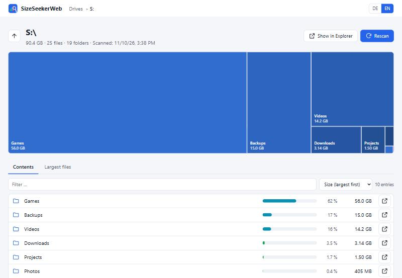
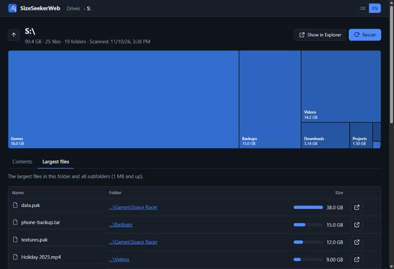

# SizeSeekerWeb

**See what takes up space on your drives – right in your browser.**

SizeSeekerWeb is a small local disk usage analyzer for Windows. It scans a drive or folder once in the
background, then lets you click through your folders instantly: sizes, percentage bars, a treemap and a list of
the largest files. It runs only on your own PC (`127.0.0.1`) – nothing is uploaded anywhere.

It is the web successor of [SizeSeeker](https://github.com/DenisMaslov02/sizeseeker), a Java/Swing desktop app.





## Features

- **Search everything**: index all local disks once, then find any file or folder by name in milliseconds –
  several words (`holiday mp4`) or wildcards (`*.pdf`, `report_202?.docx`), then show it in Explorer or open
  the folder in SizeSeekerWeb
- **Drive overview** with free/used space for every drive
- **Background scan** with live progress (folders, files, size, elapsed time) and cancel
- **Instant browsing** after the scan: sizes and share of every folder and file
- **Treemap** of the current folder – click a tile to open that folder
- **Sort & filter** by size, name or type
- **Largest files** in a folder and all subfolders (1 MB and up)
- **Show in Explorer** – opens the folder or selects the file (files are never opened or executed)
- **German / English** UI, light and dark mode
- **Tray icon** with "Open" and "Quit"

Colors of the percentage bars follow the original SizeSeeker: up to 10 % green, above 10 % blue, from 80 % red.

## Install (Windows)

1. Download `SizeSeekerWeb-Setup-<version>.exe` from the [releases](https://github.com/DenisMaslov02/SizeSeekerWeb/releases).
2. Run it. No admin rights are needed – it installs into your user profile.
3. Start **SizeSeekerWeb** from the Start menu. Your browser opens at <http://127.0.0.1:38765/>,
   and a tray icon appears next to the clock. Use it to reopen the page or to quit.

Windows SmartScreen may warn about an unknown publisher because the installer is not code-signed.
Choose *More info → Run anyway* if you trust the release.

## Run from source

Requires Python 3.12+.

```bash
git clone https://github.com/DenisMaslov02/SizeSeekerWeb.git
cd SizeSeekerWeb
python -m venv .venv
.venv\Scripts\activate
pip install -e ".[dev]"
python -m sizeseekerweb            # tray icon + browser
python -m sizeseekerweb --no-tray  # console mode, stop with Ctrl+C
```

Options: `--port <n>` (or env `SIZESEEKERWEB_PORT`), `--no-browser`, `--no-tray`.
Env `SIZESEEKERWEB_DATA` moves the data folder (logs, search index), e.g. for a second dev instance.
Logs are written to `%LOCALAPPDATA%\SizeSeekerWeb\sizeseekerweb.log`.

## Build the installer

```powershell
winget install JRSoftware.InnoSetup
powershell -ExecutionPolicy Bypass -File packaging\build.ps1
```

This creates `dist\SizeSeekerWeb\` (PyInstaller, no console window) and `dist\SizeSeekerWeb-Setup-<version>.exe`
(Inno Setup). Pushing a tag like `v1.0.0` builds the installer in GitHub Actions and attaches it to a release.

## How it works

| Part | Tech |
|---|---|
| Backend | Python, FastAPI, Uvicorn |
| Scanner | `os.scandir` with a pool of worker threads; keeps a tree of directories with aggregated sizes |
| Frontend | Plain HTML/CSS/JavaScript modules, no build step, works offline |
| Tray | pystray + Pillow |
| Packaging | PyInstaller + Inno Setup |

- The scan keeps **directories only** (plus every file of 1 MB or more for the "largest files" view). Files of the
  folder you are looking at are listed live. A fully scanned system drive with ~1.5 million files takes about
  20–30 seconds and ~150 MB of RAM; up to four scans are kept in memory.
- **Search index** ("Index everything" on the start page): walks every fixed local disk with NTFS, ReFS or exFAT
  (cloud drives such as Google Drive and network/USB drives are skipped) and streams all names into flat files
  under `%LOCALAPPDATA%\SizeSeekerWeb\index`. Searching memory-maps those files and uses `bytes.find` on the
  lowercased names. Measured on a PC with five disks: 5.07 million entries, built in 5.5 minutes, 381 MB on disk,
  searches in 3–150 ms. The index is only rebuilt when you click "Re-index"; the old one stays searchable until
  the new one is complete. Uninstalling removes it.
- Symlinks and junctions are not followed, so nothing is counted twice.
- Sizes are logical file sizes. Folders without read permission are skipped and reported.

### Security

The server listens on `127.0.0.1` only. Requests must carry a `Host` header for that address (protects against
DNS rebinding), and every state-changing request needs a custom header that other websites cannot send – so a
web page you visit cannot start scans or open Explorer windows. A strict Content Security Policy is set.

## API

| Method | Path | Purpose |
|---|---|---|
| GET | `/api/drives` | drives with total/used/free bytes |
| POST | `/api/scans` `{"path"}` | start a scan |
| GET | `/api/scans/current` | progress of the current scan |
| DELETE | `/api/scans/current` | cancel |
| GET | `/api/folder?path=` | entries of a folder with sizes and percentages |
| GET | `/api/largest?path=&limit=` | largest files below a folder |
| POST | `/api/reveal` `{"path"}` | show in Explorer |
| GET | `/api/index` | search index info and build progress |
| POST | `/api/index` | build the search index of all local disks |
| DELETE | `/api/index/build` | cancel indexing |
| GET | `/api/search?q=&kind=all\|dir\|file&limit=` | search names (words and `*`/`?` wildcards) |

POST/DELETE requests need the header `X-SizeSeeker: 1`.

## Tests

```bash
python -m pytest
```

## License

[MIT](LICENSE)
